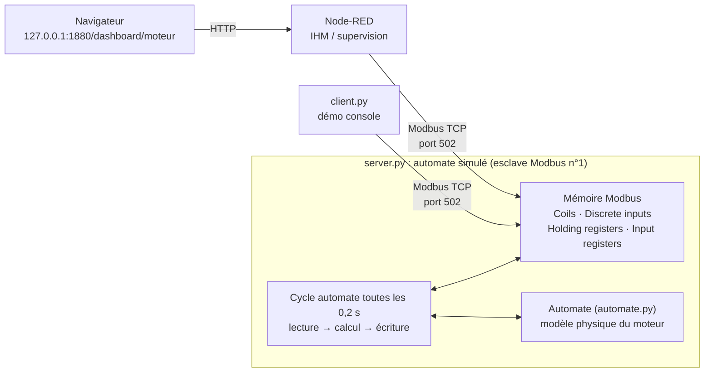
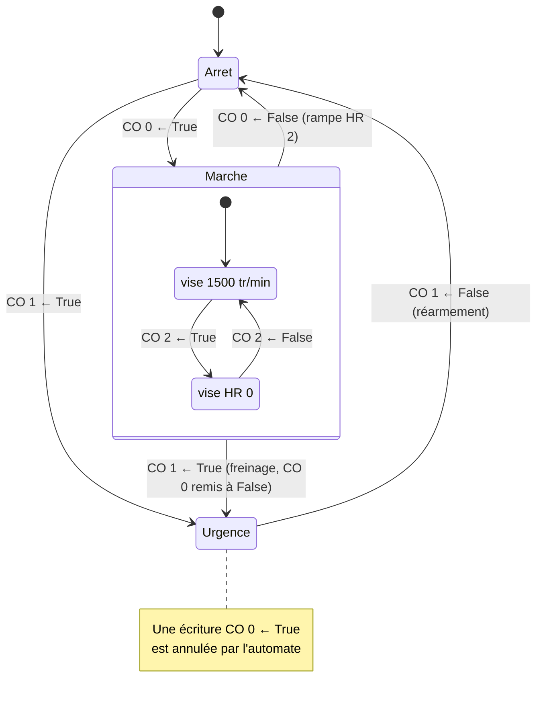
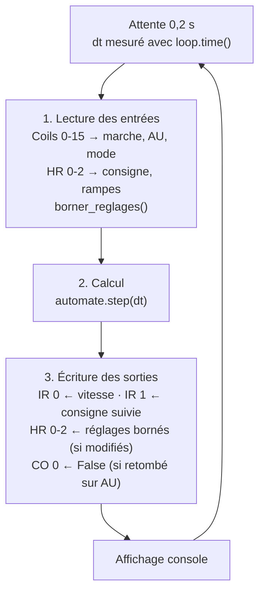
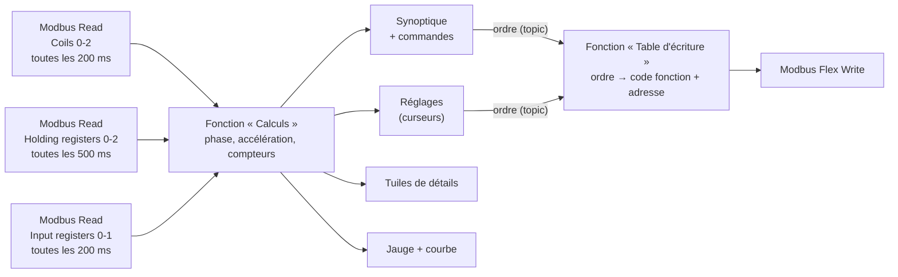

# Simulation d'automate moteur asynchrone en Modbus TCP

> 📄 **Table d'échange Modbus (coils, discrete inputs, holding et input registers) : [TABLE_MODBUS.md](TABLE_MODBUS.md)**

Ce projet simule un **automate programmable industriel (API / PLC)** qui pilote un **moteur asynchrone** et expose ses commandes, ses réglages et son capteur de vitesse sur le réseau en **Modbus TCP**.

- Le **serveur** (l'automate) est écrit en Python avec [pymodbus](https://pymodbus.readthedocs.io/).
- Deux **clients** viennent piloter l'automate : un script console et une **IHM graphique Node-RED**.

Toute la communication passe par la mémoire Modbus de l'automate (coils et registres) : l'IHM ne fait qu'écrire des ordres et relire des valeurs, comme une supervision réelle face à un vrai automate.

---

## Sommaire

1. [Architecture](#1-architecture)
2. [Rappels sur Modbus](#2-rappels-sur-modbus)
3. [Table d'échange Modbus de l'automate](#3-table-déchange-modbus-de-lautomate)
4. [Comportement de l'automate](#4-comportement-de-lautomate)
5. [Explication du code](#5-explication-du-code)
6. [IHM Node-RED](#6-ihm-node-red)
7. [Installation et utilisation](#7-installation-et-utilisation)
8. [Tester à la main avec un client Modbus](#8-tester-à-la-main-avec-un-client-modbus)
9. [Dépannage](#9-dépannage)

---

## 1. Architecture



*Diagramme réalisé avec l'aide d'une IA (Claude).*

| Rôle | Fichier | Description |
|------|---------|-------------|
| Table d'échange | `src/tp_simu_auto/modbus_map.py` | Adresses Modbus, port, numéro d'esclave, facteurs d'échelle. **Seule source de vérité** des adresses côté Python. |
| Modèle physique | `src/tp_simu_auto/automate.py` | Classe `Automate` : état du moteur, réglages, rampes, arrêt d'urgence. Ne connaît rien de Modbus. |
| Serveur Modbus | `server.py` | Crée la mémoire Modbus, la fait vivre en appelant le modèle physique toutes les 0,2 s. |
| Client console | `client.py` | Démarre le moteur, affiche la vitesse, l'arrête. |
| IHM | `nodered/flows.json` | Flow Node-RED : lectures/écritures Modbus et tableau de bord graphique. |

La séparation est volontaire : **la physique** (`automate.py`) est indépendante du **protocole** (`server.py`), et **les adresses** sont centralisées (`modbus_map.py`).

---

## 2. Rappels sur Modbus

Modbus est un protocole **maître / esclave** (aujourd'hui on dit plutôt **client / serveur**). Le client (ici l'IHM ou `client.py`) envoie des requêtes ; le serveur (ici l'automate) répond. Le serveur ne prend jamais l'initiative d'envoyer des données.

En **Modbus TCP**, les trames circulent sur un réseau Ethernet, par défaut sur le **port 502**. Chaque requête contient un **numéro d'esclave** (*unit id* / *device id*), ici **1**.

### Les quatre zones mémoire

Un équipement Modbus expose quatre zones mémoire distinctes. Chacune a sa propre numérotation qui commence à 0.

| Zone | Taille d'une case | Accès par le client | Usage typique |
|------|-------------------|---------------------|---------------|
| **Coils** (bobines) | 1 bit | Lecture **et** écriture | Sorties TOR, commandes marche/arrêt |
| **Discrete Inputs** (entrées TOR) | 1 bit | Lecture seule | Capteurs TOR (fin de course, bouton...) |
| **Holding Registers** (registres de maintien) | 16 bits | Lecture **et** écriture | Consignes, paramètres |
| **Input Registers** (registres d'entrée) | 16 bits | Lecture seule | Mesures analogiques |

Les variables du projet placées dans chaque zone sont toutes listées dans le tableau unique de la [section 3](#3-table-déchange-modbus-de-lautomate).

« Lecture seule » s'entend **du point de vue du client** : le client ne peut pas écrire dans un input register, mais l'automate lui-même y écrit ses mesures à chaque cycle.

### Les codes fonction

Chaque requête Modbus porte un **code fonction** qui indique la zone visée et l'opération :

| Code | Nom | Zone | Utilisé par |
|------|-----|------|-------------|
| 1 | Read Coils | Coils | `client.py`, Node-RED |
| 2 | Read Discrete Inputs | Discrete inputs | — |
| 3 | Read Holding Registers | Holding registers | Node-RED |
| 4 | Read Input Registers | Input registers | `client.py`, Node-RED |
| 5 | Write Single Coil | Coils | `client.py`, Node-RED |
| 6 | Write Single Register | Holding registers | Node-RED |
| 15 | Write Multiple Coils | Coils | — |
| 16 | Write Multiple Registers | Holding registers | — |

### Adressage : 0 ou 40001 ?

Dans ce projet, **toutes les adresses sont données à partir de 0**, comme dans la trame Modbus et dans pymodbus. Certains logiciels (Modbus Poll, documentations d'automates) utilisent une notation « historique » avec un préfixe de zone et un décalage de 1 :

| Zone | Adresse dans ce projet | Notation historique |
|------|------------------------|---------------------|
| Coil | 0 | 00001 |
| Discrete input | 0 | 10001 |
| Input register | 0 | 30001 |
| Holding register | 0 | 40001 |

Ainsi, la rampe d'accélération (holding register **1**) correspond à **40002** en notation historique.

### Valeurs sur 16 bits et facteur d'échelle

Un registre contient un entier non signé de **0 à 65 535**. Pour transmettre une grandeur physique, on définit un **facteur d'échelle** : `valeur registre = valeur physique × échelle`. Ici l'échelle vaut **1** (1 point = 1 tr/min, ou 1 tr/min/s pour les rampes), ce qui suffit car la vitesse est entière et inférieure à 65 535. Les fonctions de conversion sont dans `modbus_map.py` : si l'on voulait le dixième de tr/min, il suffirait de passer `ECHELLE_VITESSE` à 10.

---

## 3. Table d'échange Modbus de l'automate

Serveur : **port 502**, **esclave n°1**. Adresses à partir de 0. **Toutes les variables Modbus du projet sont dans ce tableau unique.**

| Table Modbus | Nature | Accès client | Codes fonction | Adr. | Notation hist. | Variable | Constante Python (`modbus_map.py`) | Attribut Python (`Automate`) | Topic Node-RED (écriture) | Unité | Plage | Défaut |
|--------------|--------|--------------|----------------|------|----------------|----------|------------------------------------|------------------------------|---------------------------|-------|-------|--------|
| Coil | Bit TOR — commande | Lecture / écriture | 1, 5, 15 | 0 | 00001 | Marche / arrêt du moteur (`True` = marche). **Remis à `False` par l'automate en arrêt d'urgence** | `CO_MOTEUR` | `moteur_en_marche` | `marche` | — | `False` / `True` | `False` |
| Coil | Bit TOR — commande | Lecture / écriture | 1, 5, 15 | 1 | 00002 | Arrêt d'urgence (`True` = enclenché, `False` = réarmé) | `CO_ARRET_URGENCE` | `arret_urgence` | `urgence` | — | `False` / `True` | `False` |
| Coil | Bit TOR — commande | Lecture / écriture | 1, 5, 15 | 2 | 00003 | Mode (`False` = automatique, `True` = manuel) | `CO_MODE_MANUEL` | `mode_manuel` | `manuel` | — | `False` / `True` | `False` |
| Coil | Bit TOR | Lecture / écriture | 1, 5, 15 | 3 à 15 | 00004 à 00016 | Réservés, non utilisés | — | — | — | — | `False` / `True` | `False` |
| Discrete Input | Bit TOR — état | Lecture seule | 2 | 0 à 15 | 10001 à 10016 | Non utilisées (zone présente mais vide) | — | — | — | — | `False` | `False` |
| Holding Register | Mot 16 bits — paramètre / consigne | Lecture / écriture | 3, 6, 16 | 0 | 40001 | Consigne de vitesse du mode manuel. **Bornée par l'automate** | `HR_CONSIGNE_MANUELLE` | `consigne_manuelle` | `consigne` | tr/min | 0 à 1500 | 750 |
| Holding Register | Mot 16 bits — paramètre | Lecture / écriture | 3, 6, 16 | 1 | 40002 | Rampe d'accélération. **Bornée par l'automate** | `HR_RAMPE_MONTEE` | `vitesse_montee` | `rampe_montee` | tr/min/s | 50 à 3000 | 300 |
| Holding Register | Mot 16 bits — paramètre | Lecture / écriture | 3, 6, 16 | 2 | 40003 | Rampe de décélération (arrêt normal). **Bornée par l'automate** | `HR_RAMPE_DESCENTE` | `vitesse_descente` | `rampe_descente` | tr/min/s | 50 à 3000 | 150 |
| Input Register | Mot 16 bits — mesure | Lecture seule | 4 | 0 | 30001 | Vitesse de rotation mesurée | `IR_VITESSE` | `vitesse` | — (lecture seule) | tr/min | 0 à 1500 | 0 |
| Input Register | Mot 16 bits — mesure | Lecture seule | 4 | 1 | 30002 | Consigne de vitesse réellement suivie par l'automate | `IR_CONSIGNE` | `consigne` (propriété) | — (lecture seule) | tr/min | 0 à 1500 | 0 |

**Notes :**

- **Coil 0** : l'automate peut l'écrire lui-même. Si l'arrêt d'urgence est enclenché, il le remet à `False` au cycle suivant : une demande de marche pendant l'arrêt d'urgence est donc annulée.
- **Bornage des holding registers** : un client peut écrire n'importe quelle valeur de 0 à 65 535. L'automate ramène la valeur dans sa plage et **réécrit le registre corrigé** au cycle suivant. Exemple : écrire 5000 dans le holding register 1 donne 3000 à la relecture.
- **Consigne suivie (IR 1) ≠ consigne manuelle (HR 0)** : la consigne suivie est la vitesse que l'automate vise réellement en ce moment, en tenant compte du mode, de la commande de marche et de l'arrêt d'urgence (voir section 4).
- **Topic Node-RED** : nom de l'ordre envoyé par un bouton ou un curseur de l'IHM ; la fonction « Table d'écriture » le traduit en écriture Modbus (code 5 pour un coil, code 6 pour un holding register) à l'adresse indiquée.

---

## 4. Comportement de l'automate

### Scénario

- **Actionneur** : moteur asynchrone, commandé en marche/arrêt par le coil 0.
- **Capteur** : vitesse de rotation en tr/min, publiée dans l'input register 0.
- **Mode automatique** (coil 2 = `False`, par défaut) : en marche, le moteur monte à sa **vitesse nominale de 1500 tr/min**.
- **Mode manuel** (coil 2 = `True`) : en marche, le moteur rejoint la **consigne de l'opérateur** (holding register 0). Si la consigne baisse en cours de marche, le moteur ralentit jusqu'à elle.
- **Rampes** : la vitesse ne change jamais brutalement. Elle évolue à la rampe d'accélération (HR 1) ou de décélération (HR 2).
- **Arrêt d'urgence** (coil 1 = `True`) : le moteur freine à **1500 tr/min/s** (valeur fixe, non réglable), la commande de marche retombe, et toute nouvelle demande de marche est refusée tant que l'arrêt d'urgence n'est pas réarmé. Après réarmement, le moteur **ne redémarre pas tout seul** : il faut redemander la marche.

> Cet arrêt d'urgence est une simulation pédagogique. Sur une installation réelle, un arrêt d'urgence est **câblé** (chaîne de sécurité) et ne passe ni par une IHM ni par Modbus.

### Choix de la consigne suivie

À chaque cycle, l'automate détermine la vitesse visée (propriété `Automate.consigne`, publiée dans l'IR 1) :

- arrêt d'urgence enclenché (CO 1 = `True`) → **0** ;
- sinon, moteur à l'arrêt (CO 0 = `False`) → **0** ;
- sinon, mode automatique (CO 2 = `False`) → **1500 tr/min** (vitesse nominale) ;
- sinon, mode manuel (CO 2 = `True`) → **consigne manuelle** (HR 0).

### Choix de la rampe

- vitesse inférieure à la consigne suivie → **rampe d'accélération** (HR 1) ;
- vitesse supérieure à la consigne suivie, sans arrêt d'urgence → **rampe de décélération** (HR 2) ;
- vitesse supérieure à la consigne suivie, arrêt d'urgence enclenché → **freinage d'urgence à 1500 tr/min/s** ;
- vitesse égale à la consigne suivie → aucune rampe, vitesse stable.

Avec les réglages par défaut : 0 → 1500 tr/min en **5 s** (300 tr/min/s), 1500 → 0 en **10 s** (150 tr/min/s), et **1 s** en arrêt d'urgence.

### Diagramme d'états



*Diagramme réalisé avec l'aide d'une IA (Claude).*

---

## 5. Explication du code

### `src/tp_simu_auto/modbus_map.py` — la table d'échange

Ce module ne contient que des constantes et quatre petites fonctions de conversion. Il est importé par `server.py` **et** par `client.py`, si bien qu'aucune adresse n'est écrite en dur ailleurs dans le code Python.

- `PORT = 502`, `DEVICE_ID = 1` : paramètres de la liaison.
- `CO_*`, `HR_*`, `IR_*` : adresses de chaque donnée ; `NB_*` : taille de chaque zone.
- `FC_READ_COILS = 1`, `FC_READ_HOLDING_REGISTERS = 3`, `FC_READ_INPUT_REGISTERS = 4` : codes fonction. Côté serveur, ils servent seulement à **désigner la zone** lors d'un accès direct à la mémoire (`async_getValues` / `async_setValues`), même pour une écriture.
- `vitesse_vers_registre()`, `registre_vers_vitesse()`, `rampe_vers_registre()`, `registre_vers_rampe()` : conversions grandeur physique ↔ entier de registre, via `ECHELLE_VITESSE` et `ECHELLE_RAMPE`.

### `src/tp_simu_auto/automate.py` — le modèle physique

La classe `Automate` est une `dataclass` qui contient tout l'état du procédé : les commandes, le capteur de vitesse et les réglages. La correspondance entre chaque attribut et sa variable Modbus est donnée dans le tableau unique de la [section 3](#3-table-déchange-modbus-de-lautomate).

Elle contient aussi des constantes, sans lien avec Modbus : `vitesse_min` (0 tr/min), `vitesse_max` (1500 tr/min, vitesse nominale), `rampe_min` (50 tr/min/s), `rampe_max` (3000 tr/min/s) et `freinage_urgence` (1500 tr/min/s).

Trois méthodes :

- **`borner_reglages()`** ramène les trois réglages dans leurs plages avec la fonction `_borner(valeur, mini, maxi)`.
- **`consigne`** (propriété) renvoie la vitesse visée selon le tableau de la section 4.
- **`step(dt)`** fait avancer la simulation de `dt` secondes :
  1. si l'arrêt d'urgence est actif, la commande de marche retombe ;
  2. si la vitesse est sous la consigne, elle augmente de `vitesse_montee × dt` sans dépasser la consigne ;
  3. si elle est au-dessus, elle diminue de `vitesse_descente × dt` (ou `freinage_urgence × dt` en arrêt d'urgence) sans passer sous la consigne ;
  4. la vitesse est enfin bornée entre 0 et 1500.

C'est une intégration simple à pas variable : la vitesse suit une **rampe linéaire**, comme un variateur de vitesse réel.

### `server.py` — le serveur Modbus et le cycle automate

#### Création de la mémoire Modbus

`build_device()` construit un `SimDevice` (pymodbus 3.15) contenant les quatre zones :

```python
coils             = SimData(0, count=16, values=False, datatype=DataType.BITS)
discrete_inputs   = SimData(0, count=16, values=False, datatype=DataType.BITS)
holding_registers = SimData(0, values=[750, 300, 150], datatype=DataType.UINT16)
input_registers   = SimData(0, count=2,  values=0,     datatype=DataType.UINT16)
```

Les holding registers démarrent sur les valeurs par défaut de l'automate grâce à `reglages_vers_registres()`.

#### Le cycle automate

Comme un vrai API qui exécute son programme en boucle, la coroutine `simulation()` tourne toutes les **0,2 s** (`PERIODE`) en parallèle du serveur Modbus :



*Diagramme réalisé avec l'aide d'une IA (Claude).*

Détails importants :

- **`dt` est mesuré** (`loop.time()`) au lieu de prendre 0,2 s : `asyncio.sleep()` n'est pas précis, surtout sous Windows. La vitesse reste donc juste même si un cycle dure plus longtemps.
- Les écritures en retour dans les **holding registers** et le **coil 0** ne sont faites que si la valeur a changé, pour ne pas écraser inutilement une écriture d'un client.
- La console du serveur affiche à chaque cycle l'état (`ON`, `OFF` ou `AU`), le mode (`AUTO` / `MANU`), la consigne suivie et la vitesse.

`main()` crée l'automate, le serveur `ModbusTcpServer` sur `0.0.0.0:502`, lance la tâche de simulation puis `serve_forever()`. Ctrl+C arrête proprement la tâche et le serveur.

### `client.py` — le client de démonstration

Le client se connecte à `127.0.0.1:502` puis :

1. lit le coil 1 et prévient si l'arrêt d'urgence est enclenché ;
2. écrit `True` dans le coil 0 (**code 5**, Write Single Coil) pour démarrer le moteur ;
3. pendant 7 s, toutes les 0,2 s, lit le coil 0 (**code 1**) et l'input register 0 (**code 4**) et affiche la vitesse ;
4. écrit `False` dans le coil 0 pour arrêter le moteur ;
5. observe pendant 12 s le retour au repos.

La cadence d'affichage utilise une **échéance absolue** (`debut + n × INTERVALLE`) : le temps passé dans les requêtes ne fait pas dériver l'horloge.

---

## 6. IHM Node-RED

L'IHM est un flow Node-RED (`nodered/flows.json`) qui utilise les palettes `node-red-contrib-modbus` et `@flowfuse/node-red-dashboard`.

### Les nœuds du flow



*Diagramme réalisé avec l'aide d'une IA (Claude).*

- **Connexion** : nœud `modbus-client` « Automate simulé », TCP `127.0.0.1:502`, esclave 1, reconnexion toutes les 2 s.
- **Lectures** : trois nœuds Modbus Read, un par zone (coils, holding registers, input registers).
- **Calculs** : la fonction fusionne les trois lectures et calcule ce que l'automate ne fournit pas :
  - la **phase** : `URGENCE` si CO 1, sinon `ACCELERATION` si vitesse < consigne suivie, `DECELERATION` si vitesse > consigne suivie, `REGIME` si moteur en marche à la consigne, `ARRET` sinon ;
  - l'**accélération** mesurée (pente de la vitesse sur la dernière seconde) ;
  - des **compteurs** : nombre de démarrages, d'arrêts d'urgence, temps de marche, vitesse max atteinte. Ils sont gardés dans le contexte du nœud et repartent de zéro au redémarrage de Node-RED.
- **Table d'écriture** : chaque bouton ou curseur envoie un ordre avec un `topic` (`marche`, `urgence`, `manuel`, `consigne`, `rampe_montee`, `rampe_descente`). La fonction le traduit en écriture Modbus : code 5 (Write Single Coil) pour un coil, code 6 (Write Single Register) pour un holding register. L'adresse de chaque topic est donnée dans le tableau unique de la [section 3](#3-table-déchange-modbus-de-lautomate).
  Les valeurs de registre hors 0 à 65 535 sont refusées par la fonction ; le bornage fin (0 à 1500, 50 à 3000) est laissé à l'automate.

> Les adresses du flow sont saisies à la main dans les trois nœuds Modbus Read et dans la fonction « Table d'écriture ». Si `modbus_map.py` change, il faut les reporter dans le flow.

### Le tableau de bord

Page `http://127.0.0.1:1880/dashboard/moteur`, thème sombre, quatre zones :

- **Synoptique et commande** : dessin du moteur dont le ventilateur et l'accouplement tournent selon la vitesse ; phase en cours ; vitesse et consigne suivie ; sélecteur Auto / Manuel ; boutons Marche et Arrêt ; bouton d'arrêt d'urgence, remplacé par un bouton de réarmement quand il est enclenché ; état de la liaison avec l'automate.
- **Vitesse de rotation** : jauge et courbe sur la dernière minute.
- **Réglages** : trois curseurs (consigne manuelle 0 à 1500 par pas de 10, rampes 50 à 3000 par pas de 50), avec le temps de montée/descente correspondant, et un bouton « Valeurs par défaut » (750 / 300 / 150). Les curseurs affichent les valeurs **relues** dans l'automate.
- **Détails** : commande, mode, consigne suivie, vitesse, accélération, vitesse max, temps de marche, nombre de démarrages et d'arrêts d'urgence.

L'IHM ne contient aucune logique de commande : arrêt d'urgence, mode et bornage des réglages sont gérés par l'automate. Elle reflète toujours l'état réel lu dans la mémoire Modbus.

---

## 7. Installation et utilisation

Il suffit d'installer uv et Node.js, de récupérer le projet, puis de lancer le serveur Python et, au choix, le client console ou l'IHM Node-RED.

> Les parties « Installation » et « Utilisation » de ce README ont été rédigées avec l'aide d'une IA (Claude).

### Prérequis

- [uv](https://github.com/astral-sh/uv), qui installe lui-même Python 3.13 :

  ```bash
  # Linux / macOS
  curl -LsSf https://astral.sh/uv/install.sh | sh
  # Windows (PowerShell)
  powershell -c "irm https://astral.sh/uv/install.ps1 | iex"
  ```

- [Node.js](https://nodejs.org/) pour l'IHM Node-RED.

### Installation

```bash
git clone https://github.com/tom13g/demomodbus.git
cd demomodbus
uv sync                 # crée .venv, installe pymodbus et le paquet tp_simu_auto
cd nodered && npm install   # une seule fois : Node-RED et ses palettes
```

### Lancement

**1. Le serveur (l'automate)**, dans un premier terminal :

```bash
uv run server.py
```

```
Serveur Modbus TCP demarre sur le port 502 (Ctrl+C pour arreter)
Moteur=OFF | Mode=AUTO | Consigne =    0.0 | Vitesse =    0.0 tr/min
...
```

**2a. Le client console**, dans un second terminal :

```bash
uv run client.py
```

Exemple de sortie avec les réglages par défaut (valeurs indicatives, elles dépendent de l'instant où tombe le cycle automate) :

```
--- Demarrage du moteur ---
09:31:30.299 | Moteur=ON  | Vitesse =    0.0 tr/min
09:31:30.501 | Moteur=ON  | Vitesse =   60.0 tr/min
09:31:30.700 | Moteur=ON  | Vitesse =  120.0 tr/min
...                                         (+300 tr/min par seconde)
09:31:35.500 | Moteur=ON  | Vitesse = 1500.0 tr/min
...
--- Arret du moteur ---
09:31:37.500 | Moteur=OFF | Vitesse = 1500.0 tr/min
09:31:37.701 | Moteur=OFF | Vitesse = 1470.0 tr/min
...                                         (-150 tr/min par seconde)
09:31:47.500 | Moteur=OFF | Vitesse =    0.0 tr/min
```

**2b. L'IHM Node-RED**, toujours avec le serveur lancé :

```bash
cd nodered
npm start
```

Après quelques secondes :

- IHM : <http://127.0.0.1:1880/dashboard/moteur>
- Éditeur du flow : <http://127.0.0.1:1880/>

Le client console et l'IHM peuvent tourner en même temps : ils lisent et écrivent la même mémoire Modbus.

### Structure du projet

```
├── server.py                  # Serveur Modbus TCP + cycle automate
├── client.py                  # Client de démonstration en console
├── src/tp_simu_auto/
│   ├── __init__.py
│   ├── modbus_map.py          # Table d'échange : adresses, port, échelles
│   └── automate.py            # Modèle physique (dataclass Automate, méthode step)
├── nodered/
│   ├── flows.json             # Flow de l'IHM (Modbus + dashboard)
│   ├── package.json           # Node-RED et palettes, script `npm start`
│   └── settings.js            # Réglages Node-RED (port 1880, valeurs par défaut)
├── pyproject.toml             # Configuration uv et dépendances (pymodbus >= 3.15)
├── uv.lock                    # Versions verrouillées
└── LICENSE
```

### Version de pymodbus

Le code est écrit pour **pymodbus 3.15**. Le datastore y est décrit avec `SimData` / `SimDevice` (module `pymodbus.simulator`), qui remplacent `ModbusSequentialDataBlock` / `ModbusDeviceContext` des versions précédentes. L'API change entre versions mineures : avant de monter de version, vérifier le code source installé dans `.venv/Lib/site-packages/pymodbus`.

---

## 8. Tester à la main avec un client Modbus

N'importe quel client Modbus TCP (Modbus Poll, QModMaster, mbpoll...) peut piloter l'automate : `127.0.0.1`, port 502, esclave 1. Exemple avec pymodbus en Python interactif (`uv run python`) :

```python
from pymodbus.client import ModbusTcpClient
c = ModbusTcpClient("127.0.0.1", port=502); c.connect()

c.write_coil(2, True, device_id=1)          # CO 2 : mode manuel
c.write_register(0, 900, device_id=1)       # HR 0 : consigne 900 tr/min
c.write_coil(0, True, device_id=1)          # CO 0 : marche

c.read_input_registers(0, count=2, device_id=1).registers   # [vitesse, consigne suivie]

c.write_register(1, 5000, device_id=1)      # HR 1 hors plage...
c.read_holding_registers(0, count=3, device_id=1).registers  # ...relu à 3000 au cycle suivant

c.write_coil(1, True, device_id=1)          # CO 1 : arrêt d'urgence
c.read_coils(0, count=3, device_id=1).bits[:3]               # CO 0 est retombé à False
c.write_coil(1, False, device_id=1)         # réarmement (le moteur ne repart pas seul)
c.close()
```

---

## 9. Dépannage

**Port 502 indisponible.** Sous Linux, les ports inférieurs à 1024 demandent les droits administrateur (`sudo uv run server.py`). Sinon, changer `PORT` dans `src/tp_simu_auto/modbus_map.py` (et dans le nœud « Automate simulé » de Node-RED).

**Le client affiche « Connexion impossible ».** Le serveur n'est pas lancé, ou un pare-feu bloque le port 502.

**L'IHM indique que la liaison est perdue.** Vérifier que `server.py` tourne ; Node-RED se reconnecte automatiquement toutes les 2 s.

**Le moteur ne démarre pas.** Vérifier que l'arrêt d'urgence (coil 1) est réarmé, puis redemander la marche.

**En mode manuel le moteur reste à 0.** La consigne manuelle (holding register 0) est peut-être à 0.

---

## Ressources

- [Documentation pymodbus](https://pymodbus.readthedocs.io/)
- [Documentation uv](https://docs.astral.sh/uv/)
- [Node-RED](https://nodered.org/) · [FlowFuse Dashboard](https://dashboard.flowfuse.com/) · [node-red-contrib-modbus](https://flows.nodered.org/node/node-red-contrib-modbus)
- [Spécification Modbus](https://modbus.org/specs.php)
